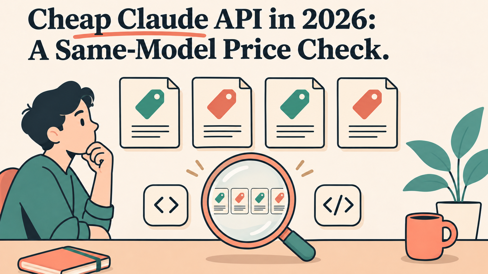

# Cheap Claude API in 2026: A Same-Model Price Check

*Compare the same model and workload before judging a low Claude API quote.*

A Claude API quote can look cheap until you ask what the number buys. Is it the same model version, the same billing unit, and the same kind of account access? For a developer choosing a route for an application, those details matter more than the largest percentage discount on a landing page.

Four public pages list different ordinary input and output token rates for **Claude Sonnet 5.5**. We will compare those listed rates in one unit, apply the same hypothetical workload to each, and then examine the conditions that could change the result. The numbers below are published quotes checked on **November 16, 2026**, not charges observed on four matched accounts. They do not establish that the routes offer identical availability, behavior, features, or support.

## A same-model price check

An input token is text sent to the model; an output token is text it generates. Providers usually price the two separately. To avoid comparing a subscription, a prepaid key, and metered usage as if they were the same product, the table uses only public **ordinary input/output prices in USD per million tokens** for pages naming Claude Sonnet 5.5. It does not include cache, batch, regional settings, taxes, add-on fees, or promotional credit.

| Published route | Ordinary input / 1M tokens | Ordinary output / 1M tokens | What the page actually establishes |
| --- | ---: | ---: | --- |
| [Anthropic](https://platform.claude.com/docs/en/about-claude/pricing) | $2.00 | $10.00 | Anthropic's published standard Sonnet 5.5 token rates. |
| [Moduck](https://moduck.ai/models/c/anthropic/claude-sonnet-5-5) | $1.60 | $8.00 | Moduck's listed Sonnet 5.5 rates; route availability and exact catalog ID require account verification. |
| [OmniaKey](https://omniakey.com/claude-sonnet-5-5) | $0.56 | $2.80 | OmniaKey's listed Sonnet 5.5 rates; its page says the final charge can vary. |
| [CheapAI](https://cheapai.io/en/claude-api) | $0.30 | $1.50 | CheapAI's public Claude API catalog names Sonnet 5.5 at these rates; the specific route and final account terms still need checking. |

On these published ordinary token numbers, CheapAI has the lowest listed ordinary input and output token rates in this four-page sample. That is a narrow finding about the displayed rate cards. It is not proof of a lower final invoice or a recommendation to move production traffic there. The pages have different levels of detail about route identity, caching, access, and billing conditions. Even where the model name matches, the configuration may not.

A search for “cheap Claude API” also surfaces prepaid keys, subscriptions, and gateways. A $100 key listing is a purchase amount, not an input-token rate. A subscription priced per month is not metered API capacity unless its terms explicitly say so. Keeping those units separate prevents a prepaid purchase amount from being mistaken for a per-token saving.

## What the rates mean for one workload

Suppose an application sends **1 million uncached input tokens** and receives **250,000 output tokens** in a billing period, all on the ordinary Sonnet 5.5 route. Assume every token qualifies for the displayed standard rates. There are no retries, cache reads or writes, batch jobs, tool charges, taxes, or other fees in this example.

The arithmetic is: **estimated usage charge = (input tokens ÷ 1,000,000 × input rate) + (output tokens ÷ 1,000,000 × output rate)**. With the stated mix, that becomes **input rate + 0.25 × output rate**.

Anthropic: $2.00 + 0.25 × $10.00 = **$4.50**. Moduck: $1.60 + 0.25 × $8.00 = **$3.60**. OmniaKey: $0.56 + 0.25 × $2.80 = **$1.26**. CheapAI: $0.30 + 0.25 × $1.50 = **$0.675** (about $0.68 if rounded to cents). These are calculations from the public table, not test invoices. For a different mix, put its measured input and output token counts into the same formula before comparing.

There is another distinction between **usage cost and cash required to begin**. Moduck's [public pricing page](https://moduck.ai/pilot/pricing) lists a $10 minimum top-up. The $3.60 hypothetical usage figure therefore does not mean a new account can start with a $3.60 payment. The table also does not apply Moduck's first-top-up bonus to the ordinary token rate. Check each provider's minimum payment, balance treatment, and account terms before calling a route “cheaper” for a small trial.

## Where the cheap quote can change

The first modifier is caching. A repeated prompt prefix may be billed differently when a provider supports a cache hit, but getting data into a cache can itself have a write price. Anthropic's Sonnet 5.5 page, for example, lists a **$2.50 per million token 5-minute cache write**, **$4.00 per million token 1-hour cache write**, and **$0.10 per million token cache read**. Those are Anthropic's published conditions, not terms verified for every gateway in the table. If the prompt changes on every call, a cache-read headline does little for the workload.

Batch processing is another conditional rate, not a general discount. Anthropic publishes Sonnet 5.5 batch rates of **$1 input and $5 output per million tokens**, but the request must fit the batch mode and its delivery constraints. An interactive support chat cannot simply be priced as a batch job because it would be cheaper. Anthropic also lists a **1.1× modifier for US-only inference**. A rate comparison should specify whether a selected processing mode or geography changes the quote rather than silently mixing modes.

The model choice can dwarf a route discount. A lighter model may handle extraction or classification work acceptably, while a harder task may need Sonnet's capability. Yet the cheaper model is only cheaper for the application if it produces an acceptable result without extra retries, review, or escalation. This is a reason to test a representative task, not a claim that a particular model will pass it.

Finally, count what the application actually sends. Long system prompts, retrieved passages, tool results, repeated context, failed calls, and retries can all raise metered usage. An attractive input rate will not rescue a workflow that sends the same large context unnecessarily. First log input and output tokens by request type, then compare routes using that distribution.

## A low rate is not the same purchase

The search results mix three mechanisms. **First-party metered access** uses the model maker's API and billing terms. **Gateway access** offers its own account and route to the named model. **Resold keys or prepaid packages** have a separate seller, balance and access arrangement. All can appear under “cheap Claude API,” but a monthly subscription or a prepaid key listing cannot be placed into the per-token table without additional terms.

The published rate tells you where to start asking questions. Before moving a production workload, confirm the exact model identifier returned by the account, the endpoint and authorization method, whether cache and batch behavior are supported, rate limits, data handling, invoice units, refunds and support. A page naming Sonnet 5.5 is useful evidence of a public offer; it does not verify what a newly created account can call today. This article did not create accounts, send model requests, or inspect invoices.

For a small trial, the key issue may be minimum cash outlay and route stability. For a high-volume application, the larger issue is whether the observed token mix and features are priced as expected. For sensitive data, data handling and contractual terms may dominate either rate. These are different decisions, even when the same table starts the investigation.

## Choose the next check before you buy

Start with one model version and a representative week of request counts, input tokens, output tokens, and cache eligibility. Recalculate the estimate for each provider's published mode, then inspect the account terms that the price card leaves open. If a lower quote still looks useful, make a small authorized test in that provider's own account and compare its actual usage record with the estimate before changing production traffic.

If Moduck is one of your candidate routes, [Read the documentation](https://docs.moduck.ai/) and check its current documentation and model availability before requesting a key. Confirm the $10 minimum top-up and account terms before making a payment. The same validation standard applies to every route here: the cheapest published rate is a lead to investigate, while the chosen route should be the one whose actual terms and measured usage fit the application.
